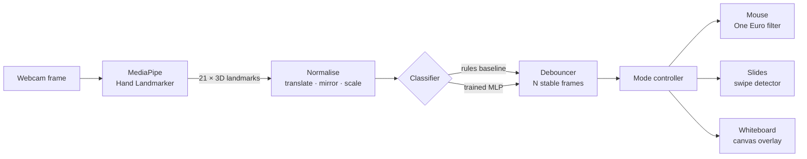

<div align="center">

# Hand Gesture Control

Control a computer without touching it: a gesture mouse, a slide remote and an air-drawing whiteboard, driven by real-time hand tracking and a classifier trained on your own recordings.

[](https://github.com/haroonkhan02/hand-gesture-control/actions/workflows/ci.yml)


</div>

<!-- <p align="center"></p> -->

## What it does

- Tracks one hand from a webcam (21 3D landmarks per frame) and recognises six static gestures.
- Mouse mode: move, click, drag, scroll and right-click. Slides mode: swipe to change slides. Draw mode: an air-drawing canvas over the video.
- Lets you record your own gesture data and train an MLP on it, compared against a rule-based baseline.
- Smooths the cursor with a One Euro filter and debounces gestures so a single bad frame can't fire a click.

## Gestures

| Gesture | Mouse mode | Slides mode | Draw mode |
|---|---|---|---|
| `point` | Move cursor | | Draw |
| `pinch` | Hold left button (click / drag) | | |
| `peace` | Scroll (move hand up/down) | | Pen up |
| `thumbs_up` | Right click | | |
| `open_palm` | Pause cursor | Swipe left: next, right: previous | Erase |
| `fist` | Pause cursor (re-centre hand) | Black screen on/off | |

Keys: `M` switch mode, `P` pause, `C` clear canvas, `K` next colour, `S` save drawing, `Q` quit.

## How it works



Landmarks are shifted so the wrist is the origin, left hands are mirrored onto right hands, and everything is divided by palm size, so the classifier sees the hand's shape rather than its position or distance. The classifier returns `none` below a confidence threshold, and a gesture must hold for N frames before it becomes active.

## Results

Hand tracking takes about 8 ms per frame on an Apple M5 CPU and classification adds under 0.1 ms, so the frame rate is limited by the camera, not the model (`gesture-benchmark`).

There is no accuracy table yet. The classifier is meant to be trained on the user's own recordings, and that dataset hasn't been recorded. Running `gesture-train` writes `reports/metrics.md` (accuracy, macro-F1, per-class report for rules vs. logistic regression vs. MLP) and `reports/confusion_matrix.png`.

## Getting started

```bash
git clone https://github.com/haroonkhan02/hand-gesture-control.git
cd hand-gesture-control
uv venv --python 3.12 && source .venv/bin/activate
uv pip install -e ".[dev]"

gesture-download-model          # MediaPipe hand model (~8 MB)
gesture-control --dry-run       # recognise gestures without moving the mouse
gesture-control --mode mouse    # rule-based gestures until you train a model
```

`--source clip.mp4` runs on a video file instead of the webcam. On macOS the terminal needs Camera and Accessibility permissions (System Settings → Privacy & Security); Accessibility is what allows it to move the mouse and press keys.

Train a classifier on your own hand:

```bash
gesture-collect point --seconds 20   # repeat for each gesture, on 2+ separate occasions
gesture-train                        # rules vs. logistic regression vs. MLP
gesture-control                      # picks up the trained model automatically
gesture-benchmark --frames 300       # per-stage latency on your machine
```

Tests need no camera: `pytest` (47 tests) and `ruff check .`.

## Repository structure

```text
hand-gesture-control/
├── src/gesture_control/
│   ├── app.py            # webcam loop, modes, HUD
│   ├── tracking.py       # MediaPipe Hand Landmarker wrapper
│   ├── features.py       # landmark normalisation, finger geometry
│   ├── gestures.py       # rule-based and learned classifiers, debouncer
│   ├── filters.py        # One Euro filter
│   ├── controllers.py    # mouse and slide controllers, swipe detector
│   ├── whiteboard.py     # air-drawing canvas
│   ├── hud.py            # on-screen overlay, FPS counter
│   ├── dataset.py        # landmark CSV read/write
│   ├── collect.py        # record labelled samples
│   ├── train.py          # train and evaluate classifiers
│   ├── benchmark.py      # per-stage latency
│   ├── download.py       # fetch the MediaPipe model
│   └── config.py         # paths, gesture names, landmark indices
├── tests/                # synthetic hand poses, fake input backend
├── data/                 # your recorded landmarks (gestures.csv)
├── models/               # downloaded and trained models (git-ignored)
├── reports/              # metrics, confusion matrix, benchmark
└── pyproject.toml
```

## Design decisions

| Decision | Why |
|---|---|
| Session-level train/test split | Consecutive frames are near-duplicates, so a random split leaks them into the test set. Holding out each gesture's latest recording session tests generalisation to a new recording. |
| Cursor follows the index knuckle, not the fingertip | Pinching to click moves the fingertip; the knuckle stays put, so clicks land where you aimed. |
| One Euro filter | Smooths heavily when the hand is still and lightly when it moves fast, removing jitter without adding lag. |
| Rules baseline kept alongside the MLP | Works with no training data and gives the learned model something to beat. |
| MediaPipe pinned to 0.10.21 | 1.0.x crashes on recent macOS (Metal graph service). |

## Limitations and future work

- No accuracy numbers until a gesture dataset is recorded, and a model trained on one person's hand may not transfer to others.
- Static gestures only. Dynamic gestures (circle to undo) would need a small temporal model (GRU/TCN) over landmark sequences.
- Two-hand gestures (zoom, rotate) and an ONNX export for running in the browser with MediaPipe JS.

## License

[MIT](LICENSE) © Muhammad Haroon Khan
